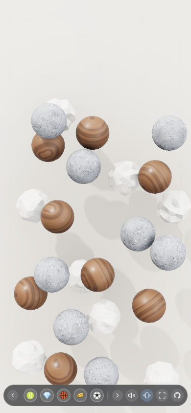

# Gravity Watch Face

[简体中文](README.md) · [Open the site](https://gravity-watch-face.xiaosang.cc/) · [GitHub](https://github.com/holynova/gravity-watch-face)

Tilt your phone or drag the desktop gimbal to tumble 18 real-time 3D PBR physics scenes: alongside courts, gold bars, bulbs, dice, marbles, ice, and porcelain, explore Super Bouncy Balls, Crumpled Paper, Wood Spheres, Stone Spheres, and a mixed Paper · Wood · Stone lab tray.



Features open-source CC0 recorded collision audio (Kenney Impact Sounds & Meta Open Sound), per-material haptics, unmistakable vector pictogram swatches, and one-tap Previous / Next scene controls.

## Run locally

```sh
npm install
npm run dev
```

For mobile sensor testing on your local network, run `npm run dev:https`.

Publish the Cloudflare Worker from `main` with `npm run deploy`.

<a href="https://gravity-watch-face.xiaosang.cc/"></a>

Cloudflare Workers Builds runs `npm run build` and deploys the production Worker after `git push origin main`.
