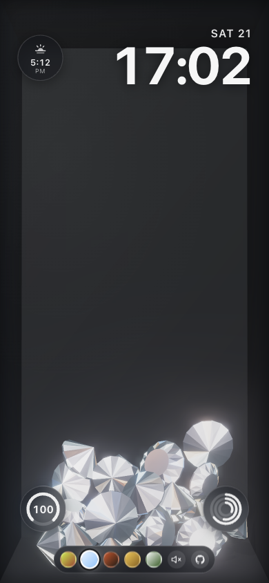

# Gravity Watch Face · 物理重力交互表盘

中文：基于 Three.js PBR、HDR 工作室环境光与 cannon-es 3D 刚体物理引擎打造的手机全屏重力互动表盘。支持真实设备运动与朝向传感器（兼容 iOS 权限授权与 Android 自动监听），倾斜手机即可驱动网球场、钻石库、篮球场、黄金库与足球场五套主题中的物体翻滚、碰撞、堆积并伴随动态接触阴影与桌面 360° 倾角模拟。

English: A mobile-first 3D physics interactive watch face powered by Three.js PBR, procedural HDR studio lighting, and cannon-es rigid-body physics. Driven by real device motion and orientation sensors (with iOS permission support and desktop 360° tilt simulation), tilting your phone tumbles objects across five themes—Tennis, Diamonds, Basketball, Gold Bars, and Soccer—with grounded contact shadows and natural specular fire.



## 在线体验 / Live Demo

- [Cloudflare Demo](https://gravity-watch-face.xiaosang.cc/)
- [GitHub Repo](https://github.com/holynova/gravity-watch-face)


## 本地运行 / Run locally

```bash
npm install
npm run dev
```

For HTTPS mobile sensor testing over LAN:

```bash
npm run dev:https
```

## 发布 / Deploy

```bash
npm run deploy
```

Cloudflare Workers · Custom Domain: `gravity-watch-face.xiaosang.cc`

源码与部署配置均在 `main` 主分支维护；在本地构建并手动执行发布，不创建 Cloudflare 专用分支或 GitHub Action。
